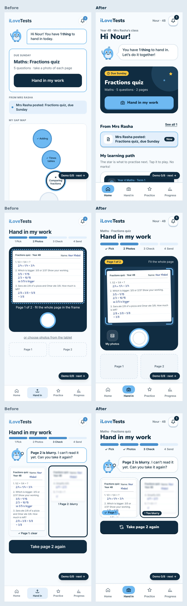
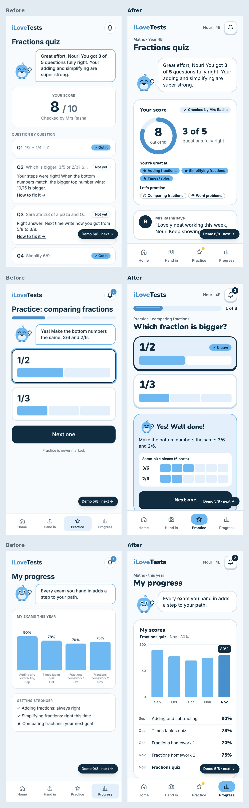

# iLoveTests: student portal redesign

This folder holds a redesign of the student view of
[csen909-ilovetests](https://github.com/CodeNKoffee/csen909-ilovetests). It sits here only so it could
be saved from a phone session. It has nothing to do with the rest of this repository.

| Before → after | |
|---|---|
|  |  |

## Apply it to the iLoveTests repo

```bash
cd csen909-ilovetests
git checkout -b student-portal-ux
git am /path/to/student-portal-ux.patch   # one commit; adds @fontsource/nunito
npm install
npm run dev                                # open http://localhost:3000/student/
```

`files/` has the same changed files laid out at their repo paths, if you'd rather copy them by hand
(then run `npm install @fontsource/nunito`).

## What changed

Same palette and rules as Phase 1: no red, text in navy, sky and azure only as fills. Sun yellow is
new, and only for stars. The teacher and parent views are unchanged.

- **Shell:** rounded headings (Feather Bold where installed, else Nunito instead of Inter),
  chunky 3D buttons and tiles that press down, a tab bar that stays on screen on phones, and a
  Messages sheet behind the bell (it used to link back to Home).
- **Home:** one hero card per state (to hand in, being checked, back), a "where is my quiz" tracker,
  a practice card when Mrs Rasha recommends one, and the Gap Map as a learning path with a trail.
- **Hand in:** tips for a clear photo, a camera viewfinder, thumbnails with status, a short
  "Lukki is checking" step, and stars after sending. **My photos** now opens real photos and runs a
  sharpness check in the browser.
- **Results:** praise first, then a score ring, "You're great at" and "Let's practise", the full
  question text with marks, and **How to fix it** listing each mark-scheme step as done or not yet.
- **Practice:** pick, then Check. A feedback panel draws the tip as same-size pieces, a miss does not
  give the answer away, and there is Play again.
- **Progress:** a score chart with a list view, plus skill levels written in words.
- **Fixes:** reloading Hand in after sending no longer restarts the wizard. Gap Map topics no longer
  overlap or run off the screen.

## Checked

- `next build` and `tsc --noEmit` pass.
- A browser test runs the whole hand-in flow: the blur check, retake, send and reload. It also tries
  the photo picker with a sharp image and a blurry one, opens and closes Messages (Esc, focus back on
  the bell) and plays all three practice rounds.
- No sideways scrolling at 320 px or 1280 px on any student page.
- Contrast follows the Phase 1 pairs. Motion stops under "reduce motion".
- Not tested with pupils yet.
