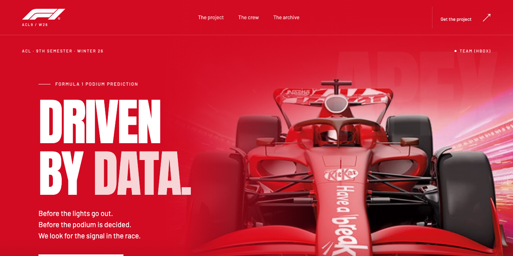
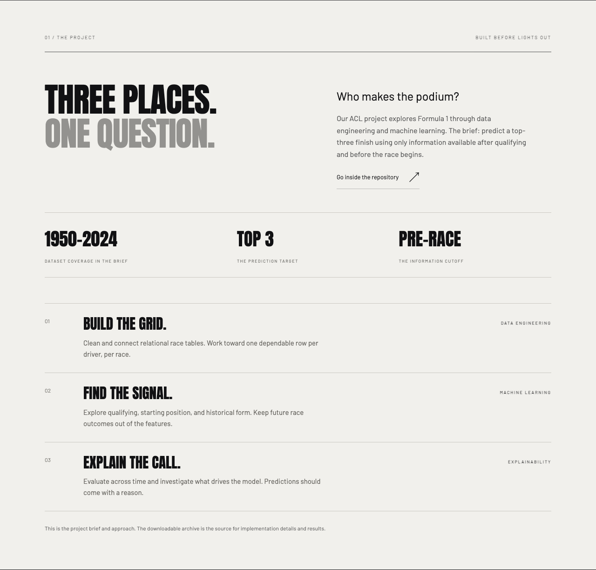
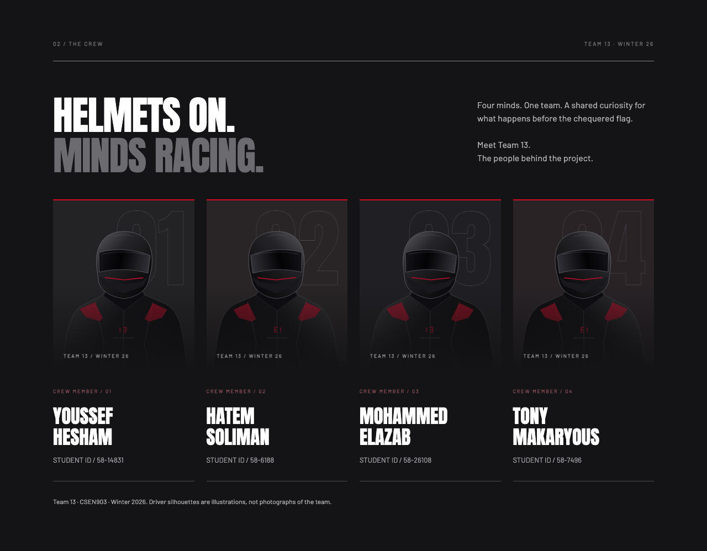
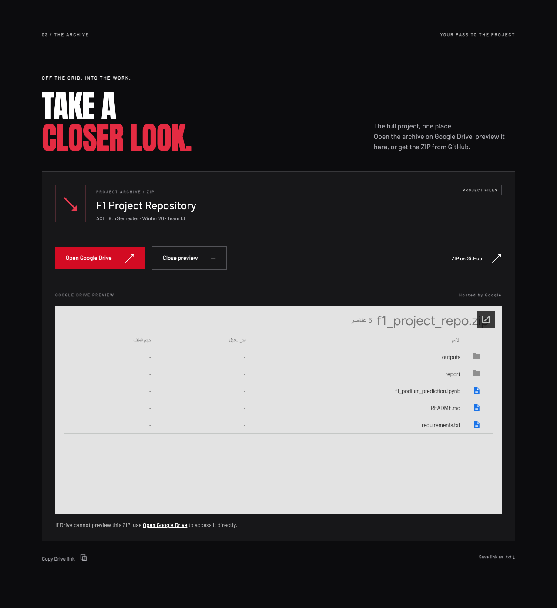

<a href="#run-locally"><picture>
  <source media="(prefers-color-scheme: dark)" srcset="readme/banner-dark.png">
  
</picture></a>

<div align="center">

# Website development guide

**ACL · 9th Semester · Winter 26 · Team 13**

[Project archive](https://drive.google.com/file/d/1DqSlh85tX_Q4ai2vMS4IBDJC6TlLHCPO/view?usp=sharing) · [Run locally](#run-locally) · [Deploy](#deploy-your-own) · [User guide](wiki/Home.md) · [GitHub Wiki](https://github.com/CodeNKoffee/acl9-winter26-team13/wiki)

<a href="CHANGELOG.md"></a>
<a href="../../LICENSE"></a>


</div>

<p align="center"></p>

<p align="center"><sub>Lights-out intro, recorded from the website.</sub></p>

## The trailer

Before the race starts, the question is already there: **who makes the podium?** Team 13 is the public front door for our Formula 1 podium-prediction project. A dark racing intro opens onto a red car hero, an overview of the academic brief, the four members of Team 13, and direct access to the project files.

The site is a showcase and archive hub. It does not execute a model or present unverified prediction scores.

| | |
|---|---|
|  **Driven by data.** The supplied KitKat car image with a red fade and racing typography. |  **Before lights out.** The pre-race cutoff and project approach, explained plainly. |
|  **Helmets on.** Four named members from the course roster, represented by original helmeted silhouettes. |  **Get the work.** Drive, an expanded embedded preview, GitHub ZIP, and a text link. |

<details><summary>Contents</summary>

- [Project files](#project-files)
- [Features](#features)
- [Gallery](#gallery)
- [How it works](#how-it-works)
- [Your data](#your-data)
- [How it is built](#how-it-is-built)
- [Run locally](#run-locally)
- [Deploy your own](#deploy-your-own)
- [Project structure](#project-structure)
- [Regenerate the media](#regenerate-the-media)
- [Roadmap](#roadmap)
- [Contributing](#contributing)
- [License and credits](#license-and-credits)

</details>

## Project files

**[Open the original project ZIP on Google Drive](https://drive.google.com/file/d/1DqSlh85tX_Q4ai2vMS4IBDJC6TlLHCPO/view?usp=sharing)**

- [F1 Project Repository.zip](../../F1%20Project%20Repository.zip) is already in the repository root. The website setup preserves it unchanged. Archive updates remain with the project owner.
- [project-link.txt](../project-link.txt) contains the normal shared Drive link, the preview URL, and the repository URL.
- The website embeds `https://drive.google.com/file/d/1DqSlh85tX_Q4ai2vMS4IBDJC6TlLHCPO/preview` in a preview that starts expanded. The browser lazy-loads the iframe near the archive section; **Close preview** and **Preview archive** smoothly collapse and reopen it.

Drive may not render every ZIP. **Open Google Drive** and **ZIP on GitHub** remain available. Drive sharing settings are controlled by the file owner.

## Features

| Feature | What happens |
|---|---|
| Racing intro | A dark car, Team 13 wordmark, and five red lights fade into the red hero. |
| Project overview | Explains the podium target, dataset coverage from the brief, and pre-race information cutoff. |
| Team 13 crew | Four named silhouette cards: Youssef Hesham, Hatem Soliman, Mohammed Elazab, and Tony Makaryous. Their original student IDs appear beneath each heading. |
| Archive access | Drive link, default-open lazy iframe, GitHub ZIP link, clipboard copy, and `.txt` download. |
| Responsive layout | Desktop composition and stacked mobile sections with an accessible navigation menu. |
| Motion controls | Honors reduced-motion preferences; the intro can be replayed from the footer. |
| Simple hosting | Static HTML/CSS/JS, no runtime dependencies, accounts, database, or environment secrets. |

## Gallery

The navigation and footer use the official white F1 wordmark. The project identity and intro remain Team 13. Team 13 is matched to the supplied Winter 2026 course roster; the four team IDs are shown as supplied, and the roster document itself is not published.

The table above shows real desktop captures. [View the full mobile capture](readme/mobile.png). The [media script](../scripts/readme-media.mjs) regenerates every screenshot and the intro GIF.

## How it works

1. The page serves complete HTML; core copy and archive links work without JavaScript.
2. CSS crops and blends the supplied image into the hero. The original image file is copied without editing.
3. JavaScript handles the intro, mobile menu, section reveals, preview toggle, and copy action.
4. The Google Drive preview starts expanded and uses native iframe lazy loading. Its expand/collapse transition and the mobile menu use CSS grid and opacity, with collapsed content removed from keyboard navigation.
5. The build copies an explicit list of website assets into `dist/`. The root ZIP stays in GitHub and is excluded from website deployment.

The website describes the supplied course brief: one driver per race, top-three target, and only information available after qualifying and before race start. It does not certify that the archived implementation meets the brief. This setup does not extract, audit, or modify the ZIP.

## Your data

No analytics, advertising scripts, cookies, local storage, login, or database are added. Intro state does not persist across visits. The copy action writes the public Drive link to your clipboard when requested.

Opening Drive or GitHub sends you to that service. The default-open preview can load a Google-hosted iframe as you approach the archive section, subject to Google's own behavior and policies. The website cannot change the archive or its sharing permissions. See [Your data](wiki/Your-Data.md).

## How it is built

| Layer | Choice |
|---|---|
| Page | Semantic HTML with accessible headings, landmarks, and a skip link |
| Design | CSS, bundled Anton and Barlow fonts, original SVG driver silhouettes |
| Interaction | Small ES modules; content links in `assets/config.js` |
| Build | Node.js file copy, no framework or bundler |
| Hosting | Vercel configuration, security headers, deployable `dist/` |
| Verification | Static link/config checks and Playwright browser checks |
| Media | Real Playwright screenshots, ffmpeg palette encoding, optional gifsicle optimization |

## Run locally

Run all website commands from the `website/` folder.

Node.js 22 or newer is required.

```sh
cd website
npm ci
npm run dev
```

Open the Local URL printed in the terminal, normally `http://127.0.0.1:4173`. The preview builds `dist/` at startup; restart it after source edits.

```sh
npm run check
npx playwright install chromium
npm test
npm run build
```

Browser checks cover the default-open archive, repeated preview toggles, collapsed keyboard access, the clipboard, `.txt` download, iframe wiring with a controlled fixture, mobile navigation, reload, six viewport widths, reduced motion, no-JavaScript preview, and production CSP. Google Drive availability is external and is not certified by the fixture.

## Deploy your own

Import `CodeNKoffee/acl9-winter26-team13` into Vercel with framework **Other** and Root Directory **`website`**. `website/vercel.json` configures install command `npm ci`, build command `npm run build`, and output directory `dist`. Leave command overrides off or use those exact values. No environment variables are needed. If an older build still runs `npm --prefix website ci`, clear the old override and deploy the latest `main` commit. See [Self hosting](wiki/Self-Hosting.md) for the full settings table.

**Deployment is left to the owner.** The metadata currently reserves the planned address [acl9-winter26-team13.hatemsoliman.dev](https://acl9-winter26-team13.hatemsoliman.dev); this is not a claim that the domain is live. Once you know the actual Vercel or custom domain, update all sharing metadata before deploying:

```sh
npm run set-url -- https://your-actual-domain.example
npm run check
npm run build
```

The URL script updates canonical/hreflang, Open Graph, Twitter, JSON-LD, sitemap, robots, guides, and the matching CSP hash. It preserves archive and repository links. See [Self hosting](wiki/Self-Hosting.md) for the domain steps.

## Project structure

```text
.
├── F1 Project Repository.zip   # unchanged academic archive
├── README.md                  # download links and overview
├── website/
│   ├── index.html             # complete showcase page
│   ├── assets/                # styles, scripts, imagery, fonts
│   ├── scripts/               # build, preview, checks, media
│   ├── docs/                  # guide, wiki source, screenshots
│   ├── vercel.json            # deploys dist/ from this folder
│   └── package.json           # website commands and tooling
├── .github/                   # community docs, templates, CI
└── LICENSE
```

## Regenerate the media

Install ffmpeg and, optionally, gifsicle, then run:

```sh
npm ci
npx playwright install chromium
npm run media
npm run check
```

The committed script captures the actual page, creates both 1280 × 640 README banners, refreshes `og.png` and icons, and records a GIF below 1 MiB. ffmpeg uses `dither=none`; when available, gifsicle runs with `-O3 --lossy=60`. No fictional screenshots or generated model metrics are used.

## Roadmap

- [ ] Add verified notebook/report links when provided by the team.
- [ ] Add model results only after checking the archived implementation.
- [ ] Connect the final Vercel/custom domain and refresh the canonical URL.

## Contributing

Read [CONTRIBUTING.md](../../.github/CONTRIBUTING.md), [CODE_OF_CONDUCT.md](../../.github/CODE_OF_CONDUCT.md), [CHANGELOG.md](CHANGELOG.md), and [SECURITY.md](../../.github/SECURITY.md). The [user guide source](wiki/Home.md) is versioned alongside the website. [Wiki publishing instructions](wiki/Contributing.md) explain how to mirror it to GitHub Wiki.

## License and credits

Website source code: [MIT](../../LICENSE), copyright © 2026 Hatem Soliman. See [LICENSE-SCOPE.md](LICENSE-SCOPE.md): the existing ZIP, its datasets/code, and third-party imagery/marks are **not** relicensed by this website's MIT license.

- **F1 wordmark:** [Original white SVG from Formula 1](https://media.formula1.com/image/upload/v1677237319/etc/designs/fom-website/images/f1_logo.svg), used in the navigation and footer. The mark remains the property of its owner and is excluded from the MIT license.
- **Car artwork:** supplied by the project owner, displayed as an academic visual reference. KitKat, Nestlé, Formula 1, and their marks remain with their respective owners. No sponsorship or affiliation is claimed.
- **Visual references:** [Raven GP](https://ravengp-ai.vercel.app) and the supplied screenshots informed the racing mood and layout. No Raven assets or code were copied.
- **Fonts:** [Anton](../assets/fonts/Anton-OFL.txt) and [Barlow](../assets/fonts/Barlow-OFL.txt), bundled under the SIL Open Font License 1.1.
- **Course context:** supplied milestone and newcomer PDFs informed the project overview; course documents are not republished here.
- **Dataset named in the brief:** [Formula 1 World Championship dataset](https://www.kaggle.com/datasets/rohanrao/formula-1-world-championship-1950-2020). Its own terms govern reuse.
- **Maintainer:** [Hatem Soliman](https://hatemsoliman.dev).
